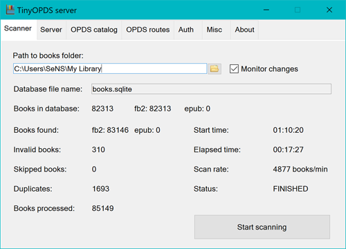

# TinyOPDS 3.21
Lightweight and powerful OPDS server for home libraries



TinyOPDS is a simple and lightweight OPDS server written in C#. Works on Windows, Linux and macOS via .NET or Mono.

## What's new in 3.21

- **Search finds titles and names with "ё"** when you type "е" and vice versa ("желтые короли" finds "Жёлтые короли")
- **Browsing authors is instant**: the first letters and author lists come from memory, without the pause after the program was idle; authors of new books appear right after a scan
- **Password protection**: reader apps stay logged in after a restart or an update (FBReader kept losing its search), phones with changing IPv6 addresses stay recognized; only wrong passwords count as failed logins and lead to a ban, which now lasts 24 hours and survives restarts
- **New log level "Logins and errors"** keeps the log small enough to leave it on; the log is rotated at 10 MB

The first start rebuilds the search index (a few seconds to a minute on a big library).

## What's new in 3.20

- **Book uploads from the web interface** - add FB2, EPUB or a zipped book from a phone or another computer: double click (double tap) the logo in the page header. Uploaded books go to the `Uploads` subfolder of the library, appear in the **Uploaded books** catalog and can be deleted from the web interface. Off by default, see [Book uploads](https://github.com/sensboston/tinyopds/wiki/Uploads_en)
- **Automatic updates** (Windows, optional) - a new release is downloaded, checked by its SHA-256 digest and installed with a restart; the update check also finds patch releases and repeats a missed notification daily
- **Series** - a book is listed in all its series, and variants of one series name (case, ё/е, blanks, a trailing dot) are merged; an existing database is fixed on the first start, a rescan adds the missing second series of books
- **EPUB covers** with blanks or other encoded characters in the image file name are shown
- **Program window** keeps its size and position after display changes (TV standby, remote desktop), a click on the tray icon brings it to the front

Upgrading from 3.18 doesn't require a rescan.

## TinyOPDS 3.18 - Revolutionary Update!

After installing this release (3.18), I strongly recommend deleting the database file (books.sqlite) and rescanning the library from scratch.

**TinyOPDS 3.18** - the result of intensive development with **over 85% of code rewritten**. The main change is the transition from in-memory storage to using a **standard SQL engine**, paving the way for porting to any server platform.

### Key changes in version 3.18:

- **SQLite database** - instead of loading the entire library into memory, now uses a standard SQL engine with FTS5 full-text search
- **Modern web interface** - fully functional embedded website with beautiful design, responsive layout, and pagination support for large collections
- **Universal web reader** - unique built-in reader for FB2 and EPUB files accessible through any browser, with functionality comparable to specialized reader apps (themes, font settings, bookmarks)
- **Revolutionary search** - unique combination of Russian Soundex and intelligent transliteration allows finding "Dostoevsky" by searching "Достоевский" and vice versa, plus typo correction
- **Dramatic memory reduction** - from 1.6GB to 120-150MB for a 500,000 book library (but for smaller libraries (80000 books), app runs even on Raspberry Pi Zero 2 W with 1GB RAM!)
- **Smart scanning** - automatic duplicate detection and removal, keeping the best versions
- **Redesigned HTTP server** - now efficiently handles parallel requests from multiple clients
- **TinyOPDSCLI** - console version renamed and modernized to current standards
- **Easy installation** - CLI now has installer option for Linux and macOS, no command line knowledge required
- **Multi-language support** - interface (GUI and embedded website) localized in 7 languages

### Real performance metrics:

| Metric | Version 2.x | Version 3.x |
|--------|------------|------------|
| Architecture | All in memory | SQL engine |
| RAM for 500K books | ~1.6 GB | ~120-150 MB |
| Web interface | Basic | Modern with pagination |
| Book reader | No | FB2 + EPUB |
| Parallel requests | Limited | Up to 100 clients |
| Typo-tolerant search | No | Yes |
| Transliteration | No | Yes |
| Duplicates | Stored | Auto-removed |
| Installers | Windows | Windows, Linux, macOS, Docker |

### System Requirements

- **.NET Framework 4.8** (Windows) or **Mono 6.0+** (Linux/macOS)
- **2+ GB RAM** minimum (for large libraries 500000+ books)
- **10 MB** for application + **2GB** for the large library database

### Docker for NAS (beta)

TinyOPDS CLI is available as a Docker image [sensboston/tinyopds](https://hub.docker.com/r/sensboston/tinyopds) (amd64 and arm64, also `ghcr.io/sensboston/tinyopds`) for Synology, QNAP, CasaOS and other NAS. The library is scanned on start, new books copied to the library folder appear by themselves.

```yaml
services:
  tinyopds:
    image: sensboston/tinyopds:latest
    ports:
      - "8080:8080"
    volumes:
      - /volume1/books:/books:ro
      - /volume1/docker/tinyopds:/data
    environment:
      - PUID=1026
      - PGID=100
      - TINYOPDS_LANGUAGE=en
    restart: unless-stopped
```

Web interface: `http://<NAS address>:8080/`, OPDS catalog: `http://<NAS address>:8080/opds`. Step by step installation for different NAS: [Docker (NAS)](https://github.com/sensboston/tinyopds/wiki/Docker_en).

> The image was not tested on real NAS hardware yet (automated tests on Linux amd64/arm64 and the CasaOS demo only). If you run it on a NAS, please report your NAS model and results in [issues](https://github.com/sensboston/tinyopds/issues).

### Documentation

For detailed documentation, installation and configuration instructions, please visit the [Project Wiki](https://github.com/sensboston/tinyopds/wiki)

### Support Development

If TinyOPDS helped organize your library, you can support development - donation links are available on the right side of this page.

---

## TinyOPDS 3.21
Легкий та потужний OPDS сервер для домашніх бібліотек

TinyOPDS - це простий та легкий OPDS сервер, написаний на C#. Працює на Windows, Linux та macOS через .NET або Mono.

## Що нового у 3.21

- **Пошук знаходить назви та імена з «ё»**, коли ви вводите «е», і навпаки («желтые короли» знаходить «Жёлтые короли»)
- **Перегляд авторів миттєвий**: перші літери та списки авторів беруться з пам'яті, без паузи після простою програми; автори нових книг з'являються одразу після сканування
- **Захист паролем**: програми для читання залишаються авторизованими після перезапуску чи оновлення (FBReader втрачав пошук), телефони зі змінною IPv6-адресою впізнаються; невдалим входом і причиною бану вважається лише неправильний пароль, бан тепер діє 24 години і зберігається після перезапуску
- **Новий рівень журналу «Входи та помилки»** - журнал достатньо малий, щоб тримати його ввімкненим; журнал ротується при 10 МБ

Перший запуск перебудовує пошуковий індекс (від кількох секунд до хвилини на великій бібліотеці).

## Що нового у 3.20

- **Завантаження книг з веб-інтерфейсу** - додавайте FB2, EPUB або запаковану книгу з телефона чи іншого комп'ютера: подвійне клацання (подвійний дотик) по логотипу в шапці сторінки. Завантажені книги потрапляють до підпапки `Uploads` бібліотеки, у розділ **Додані книги** і можуть бути видалені з веб-інтерфейсу. Типово вимкнено, див. [Завантаження книг](https://github.com/sensboston/tinyopds/wiki/Uploads_uk)
- **Автоматичне оновлення** (Windows, за бажанням) - новий реліз завантажується, перевіряється за SHA-256 і встановлюється з перезапуском; перевірка оновлень також знаходить патч-релізи і повторює пропущене сповіщення щодня
- **Серії** - книга показується в усіх своїх серіях, а варіанти назви однієї серії (регістр, ё/е, пробіли, крапка в кінці) об'єднуються; наявна база виправляється під час першого запуску, пересканування додає книгам пропущену другу серію
- **Обкладинки EPUB** з пробілами чи іншими закодованими символами в назві файлу зображення показуються
- **Вікно програми** зберігає розмір і положення після зміни дисплея (режим очікування телевізора, віддалений робочий стіл), клацання по значку в треї виводить його наперед

Оновлення з 3.18 не потребує пересканування.

## TinyOPDS отримав революційне оновлення!

Після встановлення цього релізу (3.18) я наполегливо рекомендую видалити файл бази даних (books.sqlite) і просканувати бібліотеку заново.

**TinyOPDS 3.18** - результат інтенсивної розробки, в ході якої **переписано понад 85% коду**. Головна зміна - перехід від зберігання даних в пам'яті до використання **стандартного SQL рушія**, що відкриває шлях до портування на будь-які серверні платформи.

### Ключові зміни версії 3.18:

- **SQLite база даних** - замість завантаження всієї бібліотеки в пам'ять тепер використовується стандартний SQL рушій з повнотекстовим пошуком FTS5
- **Сучасний веб-інтерфейс** - повноцінний вбудований веб-сайт з красивим дизайном, адаптивною версткою та підтримкою пагінації для великих колекцій
- **Універсальна веб-читалка** - унікальний вбудований рідер для FB2 та EPUB файлів, доступний через браузер, з функціональністю на рівні спеціалізованих додатків (теми, налаштування шрифтів, закладки)
- **Революційний пошук** - унікальна комбінація російського/англійського Soundex та інтелектуальної транслітерації дозволяє знаходити "Достоєвський" за запитом "Дастаєвський" або "Dostoevsky" і навпаки, а також виправляє друкарські помилки
- **Радикальне зниження споживання пам'яті** - з 1.6GB до 120-150MB для бібліотеки з 500,000 книг (з невеликою бібліотекою на 80000 книг, програма працює навіть на Raspberry Pi Zero 2 W з 1GB RAM!)
- **Інтелектуальне сканування** - автоматичне визначення та видалення дублікатів зі збереженням кращих версій
- **Перероблений HTTP сервер** - тепер ефективно обробляє паралельні запити від множини клієнтів
- **TinyOPDSCLI** - консольна версія перейменована та модернізована для сучасних стандартів
- **Проста установка** - в консольну версію додані інсталятори для Linux та macOS, що не потребують знання командного рядка
- **Багатомовна підтримка** - інтерфейс програми та вбудованого веб-сайту локалізовані для 7 мов

### Реальні показники:

| Метрика | Версія 2.x | Версія 3.x |
|---------|------------|------------|
| Архітектура | Все в пам'яті | SQL рушій |
| RAM для 500K книг | ~1.6 GB | ~120-150 MB |
| Веб-інтерфейс | Базовий | Сучасний з пагінацією |
| Читалка книг | Ні | FB2 + EPUB |
| Паралельні запити | Обмежено | До 100 клієнтів |
| Пошук з помилками | Ні | Є |
| Транслітерація | Ні | Є |
| Дублікати | Зберігаються | Автовидалення |
| Інсталятори | Windows | Windows, Linux, macOS, Docker |

### Системні вимоги

- **.NET Framework 4.8** (Windows) або **Mono 6.0+** (Linux/macOS)
- **2+ GB RAM** мінімум (для великих бібліотек на 500000 книг і більше)
- **10 MB** для додатку + **2GB** для бази даних книг великої бібліотеки

### Docker для NAS (бета)

TinyOPDS CLI доступний у вигляді Docker-образу [sensboston/tinyopds](https://hub.docker.com/r/sensboston/tinyopds) (amd64 і arm64, також `ghcr.io/sensboston/tinyopds`) для Synology, QNAP, CasaOS та інших NAS. Бібліотека сканується при запуску, нові книги, скопійовані в папку бібліотеки, з'являються самі.

```yaml
services:
  tinyopds:
    image: sensboston/tinyopds:latest
    ports:
      - "8080:8080"
    volumes:
      - /volume1/books:/books:ro
      - /volume1/docker/tinyopds:/data
    environment:
      - PUID=1026
      - PGID=100
      - TINYOPDS_LANGUAGE=uk
    restart: unless-stopped
```

Веб-інтерфейс: `http://<адреса NAS>:8080/`, OPDS-каталог: `http://<адреса NAS>:8080/opds`. Покрокове встановлення для різних NAS: [Docker (NAS)](https://github.com/sensboston/tinyopds/wiki/Docker_uk).

> Образ ще не перевірявся на справжніх NAS (тільки автоматичні тести на Linux amd64/arm64 і демо CasaOS). Якщо ви запустили його на NAS, повідомте, будь ласка, модель і результати в [issues](https://github.com/sensboston/tinyopds/issues).

### Документація

Детальна документація, інструкції з установки та налаштування доступні в [Wiki проекту](https://github.com/sensboston/tinyopds/wiki)

### Підтримка розробки

Якщо TinyOPDS допоміг організувати вашу бібліотеку, можете підтримати розробку - посилання на донати знаходяться праворуч на сторінці.

---

## TinyOPDS 3.21
Легкий, но мощный OPDS сервер для домашних библиотек

TinyOPDS - это простой OPDS сервер, написанный на C#. Работает на Windows, Linux и macOS через .NET или Mono.

## Что нового в 3.21

- **Поиск находит названия и имена с «ё»**, когда вы вводите «е», и наоборот («желтые короли» находит «Жёлтые короли»)
- **Просмотр авторов мгновенный**: первые буквы и списки авторов берутся из памяти, без паузы после простоя программы; авторы новых книг появляются сразу после сканирования
- **Защита паролем**: программы для чтения остаются авторизованными после перезапуска или обновления (FBReader терял поиск), телефоны с меняющимся IPv6-адресом узнаются; неудачным входом и причиной бана считается только неверный пароль, бан теперь действует 24 часа и сохраняется после перезапуска
- **Новый уровень журнала «Входы и ошибки»** - журнал достаточно мал, чтобы держать его включённым; журнал ротируется при 10 МБ

Первый запуск перестраивает поисковый индекс (от нескольких секунд до минуты на большой библиотеке).

## Что нового в 3.20

- **Загрузка книг из веб-интерфейса** - добавляйте FB2, EPUB или запакованную книгу с телефона или другого компьютера: двойной щелчок (двойное касание) по логотипу в шапке страницы. Загруженные книги попадают в подпапку `Uploads` библиотеки, в раздел **Добавленные книги** и могут быть удалены из веб-интерфейса. По умолчанию выключено, см. [Загрузка книг](https://github.com/sensboston/tinyopds/wiki/Uploads_ru)
- **Автоматическое обновление** (Windows, по желанию) - новый релиз скачивается, проверяется по SHA-256 и устанавливается с перезапуском; проверка обновлений также находит патч-релизы и повторяет пропущенное уведомление ежедневно
- **Серии** - книга показывается во всех своих сериях, а варианты названия одной серии (регистр, ё/е, пробелы, точка в конце) объединяются; существующая база исправляется при первом запуске, пересканирование добавляет книгам пропущенную вторую серию
- **Обложки EPUB** с пробелами или другими закодированными символами в имени файла изображения показываются
- **Окно программы** сохраняет размер и положение после смены дисплея (режим ожидания телевизора, удалённый рабочий стол), щелчок по значку в трее выводит его на передний план

Обновление с 3.18 не требует пересканирования.

## TinyOPDS получил революционное обновление!

После установки этого релиза (3.18) я настоятельно рекомендую удалить файл базы данных (books.sqlite) и просканировать базу заново

**TinyOPDS 3.18** - результат интенсивной разработки, в ходе которой **переписано более 85% кода**. Главное изменение - переход от хранения данных в памяти к использованию **стандартного SQL движка**, что открывает путь к портированию на любые серверные платформы.

### Ключевые изменения версии 3.18:

- **SQLite база данных** - вместо загрузки всей библиотеки в память теперь используется стандартный SQL движок с полнотекстовым поиском FTS5
- **Современный веб-интерфейс** - полноценный встроенный веб-сайт с красивым дизайном, адаптивной вёрсткой и поддержкой пагинации для больших коллекций
- **Универсальная веб-читалка** - уникальный встроенный ридер для FB2 и EPUB файлов, доступный через браузер, с функциональностью на уровне специализированных приложений (темы, настройка шрифтов, закладки)
- **Революционный поиск** - уникальная комбинация русского/английского Soundex и интеллектуальной транслитерации позволяет находить "Достоевский" по запросу "Дастаевский" или "Dostoevsky" и наоборот, а также исправляет опечатки
- **Радикальное снижение потребления памяти** - с 1.6GB до 120-150MB для библиотеки из 500,000 книг (с небольшой библиотекой на 80000 книг, программа работает даже на Raspberry Pi Zero 2 W с 1GB RAM!)
- **Интеллектуальное сканирование** - автоматическое определение и удаление дубликатов с сохранением лучших версий
- **Переработанный HTTP сервер** - теперь эффективно обрабатывает параллельные запросы от множества клиентов
- **TinyOPDSCLI** - консольная версия переименована и модернизирована для современных стандартов
- **Простая установка** - в консольную версию добавлены инсталляторы для Linux и macOS, не требующие знания командной строки
- **Мультиязычная поддержка** - интерфейс программы и встроенного веб-сайта локализованы для 7 языков

### Реальные показатели:

| Метрика | Версия 2.x | Версия 3.x |
|---------|------------|------------|
| Архитектура | Всё в памяти | SQL движок |
| RAM для 500K книг | ~1.6 GB | ~120-150 MB |
| Веб-интерфейс | Базовый | Современный с пагинацией |
| Читалка книг | Нет | FB2 + EPUB |
| Параллельные запросы | Ограниченно | До 100 клиентов |
| Поиск с опечатками | Нет | Есть |
| Транслитерация | Нет | Есть |
| Дубликаты | Хранятся | Автоудаление |
| Инсталляторы | Windows | Windows, Linux, macOS, Docker |

### Системные требования

- **.NET Framework 4.8** (Windows) или **Mono 6.0+** (Linux/macOS)
- **2+ GB RAM** минимум (для больших библиотек на 500000 книг и больше)
- **10 MB** для приложения + **2GB** для базы данных книг большой библиотеки

### Docker для NAS (бета)

TinyOPDS CLI доступен в виде Docker-образа [sensboston/tinyopds](https://hub.docker.com/r/sensboston/tinyopds) (amd64 и arm64, также `ghcr.io/sensboston/tinyopds`) для Synology, QNAP, CasaOS и других NAS. Библиотека сканируется при запуске, новые книги, скопированные в папку библиотеки, появляются сами.

```yaml
services:
  tinyopds:
    image: sensboston/tinyopds:latest
    ports:
      - "8080:8080"
    volumes:
      - /volume1/books:/books:ro
      - /volume1/docker/tinyopds:/data
    environment:
      - PUID=1026
      - PGID=100
      - TINYOPDS_LANGUAGE=ru
    restart: unless-stopped
```

Веб-интерфейс: `http://<адрес NAS>:8080/`, OPDS-каталог: `http://<адрес NAS>:8080/opds`. Пошаговая установка для разных NAS: [Docker (NAS)](https://github.com/sensboston/tinyopds/wiki/Docker_ru).

> Образ ещё не проверялся на настоящих NAS (только автоматические тесты на Linux amd64/arm64 и демо CasaOS). Если вы запустили его на NAS, сообщите, пожалуйста, модель и результаты в [issues](https://github.com/sensboston/tinyopds/issues).

### Документация

Подробная документация, инструкции по установке и настройке доступны в [Wiki проекта](https://github.com/sensboston/tinyopds/wiki)

### Поддержка разработки

Если TinyOPDS помог организовать вашу библиотеку, можете поддержать разработку - ссылки на донаты находятся справа на странице.
